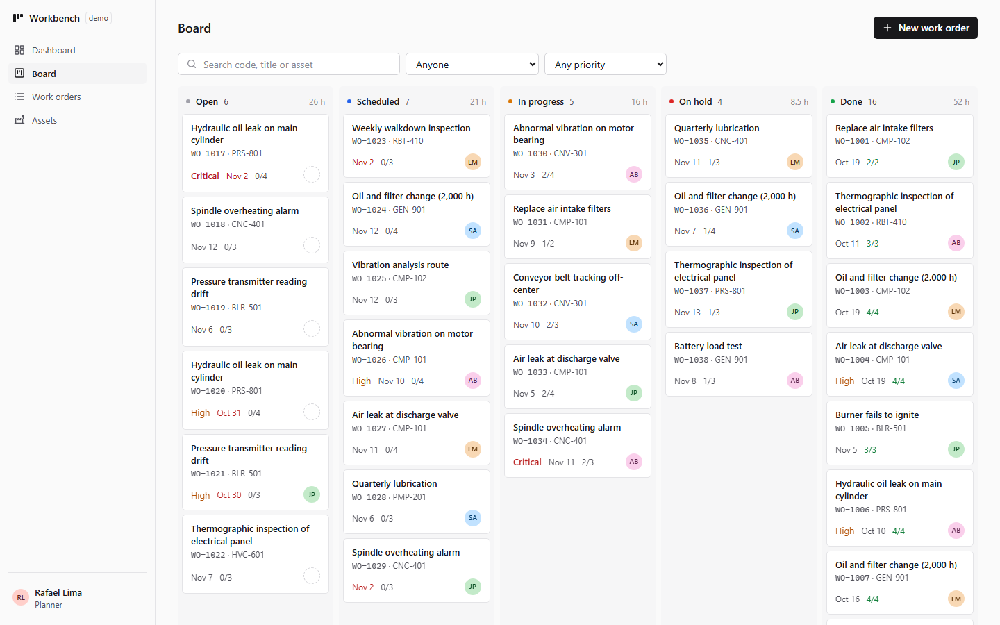
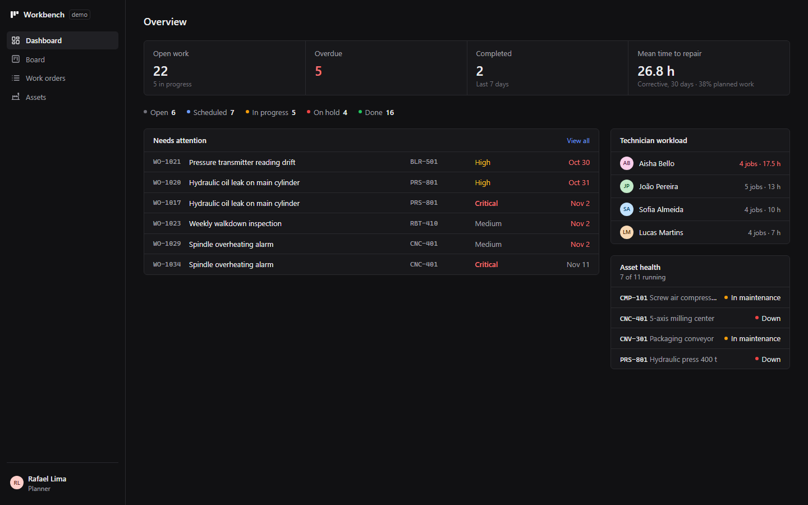
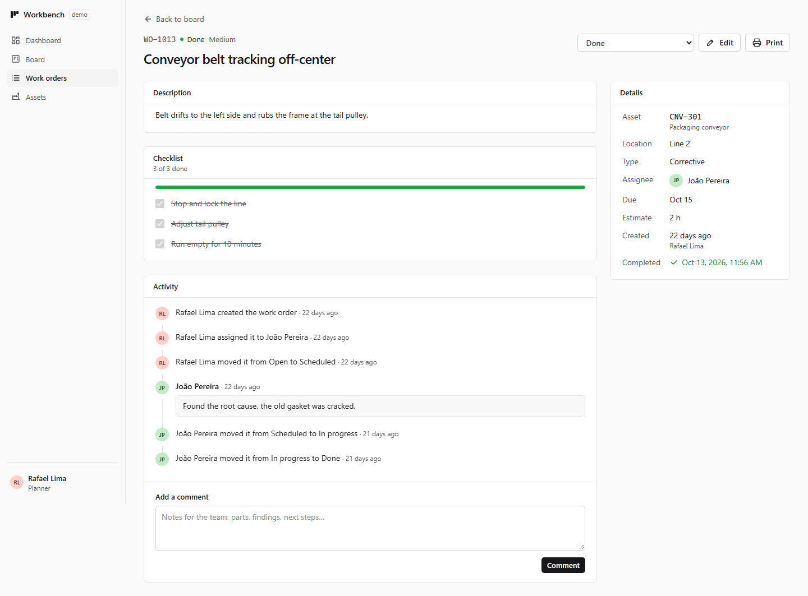

# Workbench

[](https://github.com/BielBabilonia/Workbench/actions/workflows/ci.yml)

**Maintenance work-order system with a drag-and-drop Kanban board and role-based access control**,
in the style of CMMS tools like Fiix, UpKeep or MaintainX. Planners triage and assign jobs, technicians
work through them, managers follow the numbers.

**Live demo:** _coming soon_

> The whole backend is simulated in the browser with [MSW](https://mswjs.io): create, assign, drag, comment and
> close work orders with no server. Changes persist in your browser until you hit **Reset demo data**.
> **Switch users from the account menu (bottom left)** to see the app as an admin, planner, technician or viewer.



| Dashboard (dark) | Work order |
| --- | --- |
|  |  |

## Features

- **Kanban board** — drag cards across Open → Scheduled → In progress → On hold → Done with mouse, touch
  (long press) or **keyboard** (Space, arrows), with screen-reader announcements. Optimistic: the card lands
  immediately and goes back if the server refuses. Works on a filtered board too.
- **Workflow rules** — a job needs an assignee to start, and a complete checklist to close. Blocked columns are
  dimmed while you drag and say why; the API enforces the same rules (422).
- **Role-based access control** — four roles, one permission table (`src/lib/permissions.ts`) used by both the
  UI (hidden buttons, non-draggable cards, guarded routes) and the API (403). Technicians move only their own
  work; viewers are read-only; only admins manage users. The users page shows the permission matrix.
- **Work order detail** — checklist with progress, activity timeline (status changes, assignments, comments),
  edit modal, and a print stylesheet so **Print → Save as PDF** produces a clean job sheet.
- **List and export** — filter by text, assignee, priority and status (all kept in the URL), sort, and
  **export to CSV** that opens correctly in Excel (BOM, locale delimiter, formula-injection safe).
- **Dashboard** — open/overdue work, mean time to repair, planned-work share, work by status, technician
  workload with overload warning, items needing attention, asset health.
- **Assets** — equipment with criticality; state (running / in maintenance / down) is derived from open work.
- **Polish** — account menu with demo user switcher, theme and language; no-flash theming, English and Brazilian Portuguese, keyboard and
  screen-reader friendly (native `<dialog>`, skip link, labelled controls, meaning never carried by color alone).

## Tech stack

| Area | Choice |
| --- | --- |
| UI | React 19, TypeScript (strict), Vite |
| Styling | Tailwind CSS v4 with semantic design tokens (CSS variables) |
| Server state | TanStack Query (polling, optimistic mutations with rollback, query key factory) |
| Drag and drop | dnd-kit (multiple sortable containers, keyboard sensor, custom announcements) |
| Routing | React Router (route-level code splitting, URL-driven filters) |
| Validation | Zod v4 — every type is inferred from a schema, API responses are parsed at runtime |
| API mocking | MSW v3 (Service Worker in the browser, Node server in tests) |
| Testing | Vitest + Testing Library + user-event, Playwright (desktop + mobile) |
| CI / Hosting | GitHub Actions, Vercel |

## Architecture

```
src/
  api/          schemas.ts (Zod), client.ts (typed fetch + ApiError), queries.ts (hooks, keys, mutations)
  lib/          permissions.ts (RBAC), workflow.ts (board + workflow rules), metrics.ts, csv.ts
  mocks/        seed.ts (deterministic demo data), db.ts (in-memory backend), handlers.ts (REST under /api)
  session/      demo sign-in (current user, `can(permission)`)
  features/
    board/        Kanban: columns, cards, drag and drop
    work-orders/  list, detail, form, activity timeline, filters
    dashboard/  assets/  users/
  components/   ui/ primitives (Button, Card, Modal, Toast, Badge, ...) and layout/ (shell, route guard)
```

**One source of truth for rules.** Permissions and workflow rules are plain functions in `src/lib/`. The mock
server imports them to refuse requests, and the UI imports them to avoid making requests that would be refused.
Swapping MSW for a real API means implementing the same endpoints; the UI doesn't change.

**Filtered drag and drop.** When the board is filtered, a drop position among the visible cards is mapped to the
real position in the full column (`toFullIndex`), so reordering never scrambles cards you can't see.

## Getting started

```bash
npm install
npm run dev
```

| Script | What it does |
| --- | --- |
| `npm run dev` | Dev server |
| `npm run build` | Type-check and production build |
| `npm run lint` | ESLint |
| `npm run typecheck` | TypeScript, no emit |
| `npm test` | Unit and component tests (Vitest) |
| `npm run test:e2e` | End-to-end tests (Playwright, desktop and mobile) |
